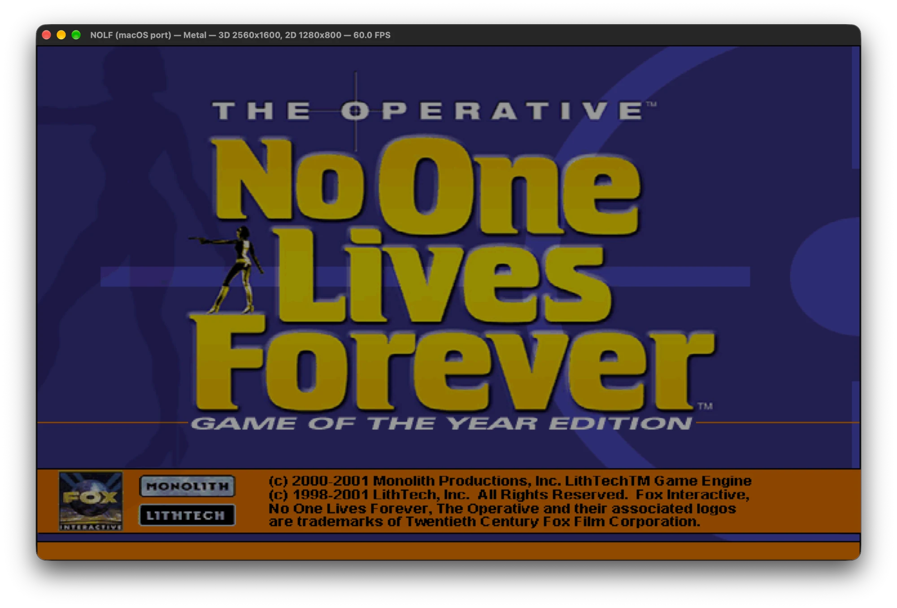
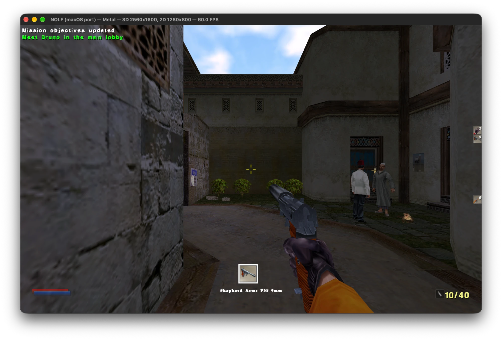

# No One Lives Forever — native macOS port

A native Apple Silicon port of *The Operative: No One Lives Forever*
(Game of the Year Edition). The game's own code runs on a LithTech 2 engine
layer written for macOS: no emulation, no Wine, no virtual machine.

## What it is

- **The original game code**, compiled for arm64 macOS: the client shell
  (interface, weapons, HUD, cinematics) and the object DLL (AI, triggers,
  doors, the mission logic).
- **A new engine** behind LithTech 2's own interface (the SDK headers):
  world, rendering, collision and physics, models and animation, sound and
  music, input, save games. The GPL Jupiter EX source (NOLF 2's engine) was
  used as a reference.
- **As close to the original as possible.** The few changes to the game's own
  sources are listed one by one in [DEVIATIONS.md](DEVIATIONS.md).

## Features

- Metal renderer (software renderer as fallback), widescreen resolutions,
  display-synced 60 fps
- CoreAudio sound; the music through the port's own DirectMusic replacement
  (DLS synth and style playback)
- The game's menus, missions, saves and quick save/load, custom key bindings
- A SwiftUI launcher (`NOLF1.app`) that finds the game data and starts the
  game

## Requirements

- A Mac with Apple Silicon and Xcode, to build
- **Your own copy of No One Lives Forever, Game of the Year Edition** — the
  installed game folder or the copied game discs. The game data is not part
  of this project.

## Building and playing

Open `NOLF1.xcodeproj` and build the `NOLF1 Launcher` scheme (it builds and
embeds `nolf1`, the engine and client, and `libnolfobject.dylib`, the game's
object DLL). Run `NOLF1.app`, press **Choose…**, point it at your game folder,
and press **Play**.

Settings are kept in `~/Library/Application Support/NOLF1`, logs in
`~/Library/Logs/NOLF1`.

## Legal

No One Lives Forever, The Operative and their associated logos are trademarks
of Twentieth Century Fox Film Corporation. LithTech is a trademark of
LithTech, Inc. This project contains no game data; you need a legally owned
copy of the game to play.
