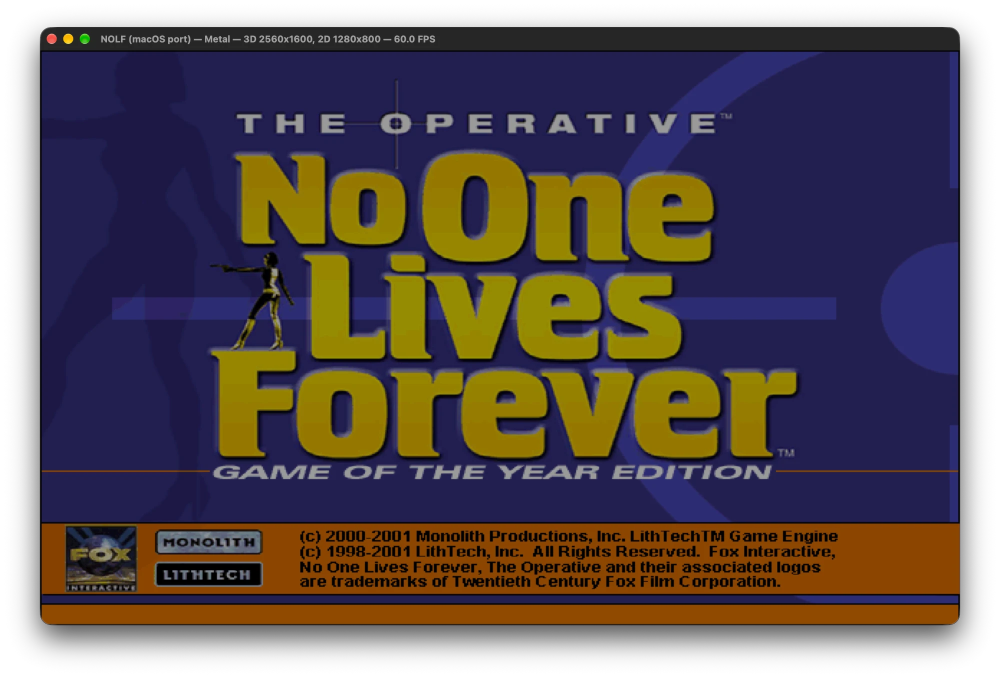
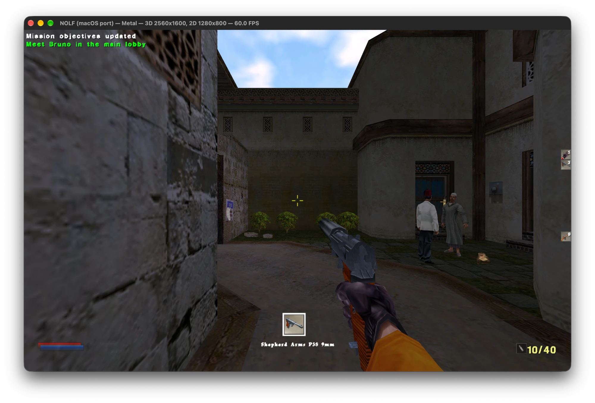

# No One Lives Forever — native macOS port

A native Apple Silicon port of *The Operative: No One Lives Forever*
(Game of the Year Edition). The game's own code runs on a LithTech 2 engine
layer written for macOS: no emulation, no Wine, no virtual machine.





## What it is

- **The original game code**, compiled for arm64 macOS: the client shell
  (interface, weapons, HUD, cinematics) and the object DLL (AI, triggers,
  doors, the mission logic).
- **A new engine** behind LithTech 2's own interface (the SDK headers):
  world, rendering, collision and physics, models and animation, sound and
  music, input, save games. The GPL Jupiter EX source (NOLF 2's engine) was
  used as a reference.
- **As close to the original as possible.** The few changes to the game's own
  sources are listed one by one in [DEVIATIONS.md](DEVIATIONS.md).

## Features

- Metal renderer (software renderer as fallback), widescreen resolutions,
  display-synced 60 fps
- CoreAudio sound; the music through the port's own DirectMusic replacement
  (DLS synth and style playback)
- The game's menus, missions, saves and quick save/load, custom key bindings
- A SwiftUI launcher (`NOLF1.app`) that finds the game data and starts the
  game

## Linux

The same engine also builds and runs natively on Linux (SDL3 window, input
and audio, an OpenGL 4.6 renderer, FreeType for the smooth fonts, a SoundFont
as the General MIDI bank). Developed on Ubuntu aarch64 (Snapdragon X, Mesa);
x86-64 builds the same way. See [LINUX.md](LINUX.md):

```sh
sudo apt install clang pkg-config python3 libsdl3-dev libfreetype-dev fonts-dejavu-core
./forditas.sh            # checks the packages, then builds build-linux/nolf1 + libnolfobject.so
NOLF_GAME_DIR="/path/to/No One Lives Forever" ./play_linux.sh
```

## Hungarian translation / Magyar fordítás

The game can run fully in **Hungarian**: menus, mission briefings and
objectives, intel documents, weapon and gadget texts and **subtitles for all
spoken dialogue** (5450 strings, `launcher/hu.txt`). No game file is changed:
the engine overlays the text file on the game's own string table at start
(`NOLF_LANG_FILE`), draws the accented letters the bitmap fonts lack
(á é í ó ö ő ú ü ű), and uses a smooth system font for menus and subtitles.

- **macOS:** the launcher's *Magyar szöveg és felirat* switch (on by default).
- **Linux:** `./play_linux.sh` is Hungarian by default; `NOLF_LANG=en ./play_linux.sh` for English.
- Details: [MAC_MAGYAR.md](MAC_MAGYAR.md), [OLVASS_EL_FORDITAS.md](OLVASS_EL_FORDITAS.md).

> **Magyarul:** A No One Lives Forever teljes magyar fordítással játszható
> macOS-en és Linuxon: menük, eligazítások, küldetéscélok, hírszerzési
> anyagok és **felirat minden párbeszédhez**. A játék fájljaihoz nem nyúl, a
> fordítás a `launcher/hu.txt`-ben van. Részletes magyar tutorial a port
> működéséről és a fordításról: <https://3d-scene.hu/nolf1/>

## Requirements

- A Mac with Apple Silicon and Xcode, or a Linux PC with clang and SDL3, to build
- **Your own copy of No One Lives Forever, Game of the Year Edition** — the
  installed game folder or the copied game discs. The game data is not part
  of this project.

## Building and playing

Open `NOLF1.xcodeproj` and build the `NOLF1 Launcher` scheme (it builds and
embeds `nolf1`, the engine and client, and `libnolfobject.dylib`, the game's
object DLL). Run `NOLF1.app`, press **Choose…**, point it at your game folder,
and press **Play**.

Settings are kept in `~/Library/Application Support/NOLF1`, logs in
`~/Library/Logs/NOLF1`.

## Legal

No One Lives Forever, The Operative and their associated logos are trademarks
of Twentieth Century Fox Film Corporation. LithTech is a trademark of
LithTech, Inc. This project contains no game data; you need a legally owned
copy of the game to play.
